# Night City · Interactive Map (Foundry VTT)

**English** · [Русский](#русский)

An interactive Night City 2045 map for **Cyberpunk RED** in Foundry VTT. Open it with **Shift+M**, open the Agent phone with **Shift+A**.

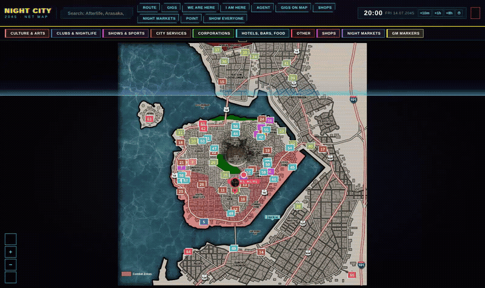

## Features

### The city
65 locations and 21 districts from the Cyberpunk RED Core rulebook, street names from Cyberpunk 2077, the Combat Zones and the Hot Zone. Filter by category, search by name, set “We are here” for the crew and “I am here” for each player.

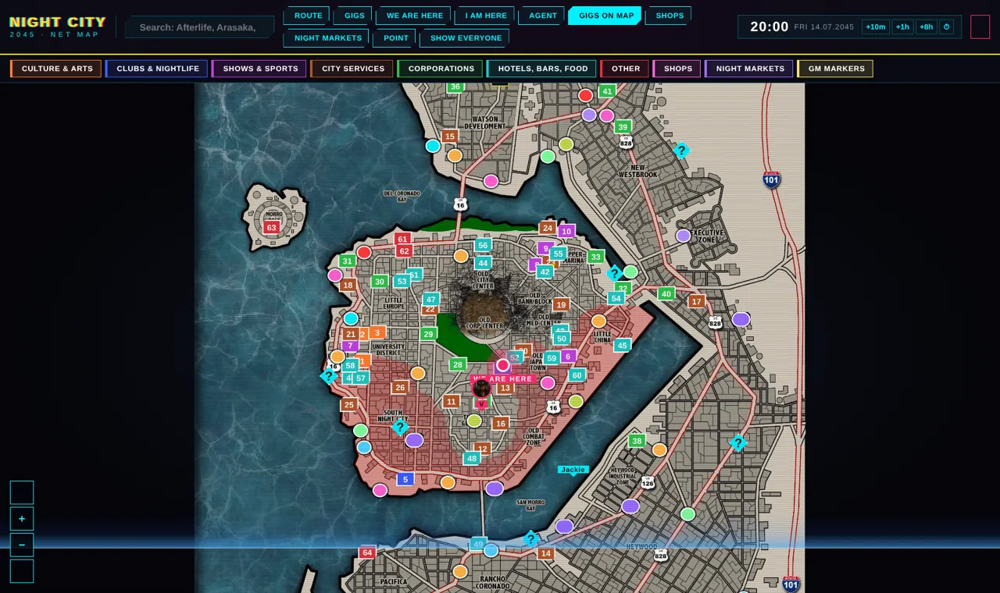

### Routes
Click places on the map, and the route follows real streets around water and blocks. You get the distance, travel time on foot, by bike, car or AV, and a warning when the route crosses a Combat Zone or the Hot Zone. *Travel* moves the clock and the crew marker, *Encounters on the way* rolls what happens on the road, and you can show the route to every player.

| Route | Encounters on the way |
|---|---|
| 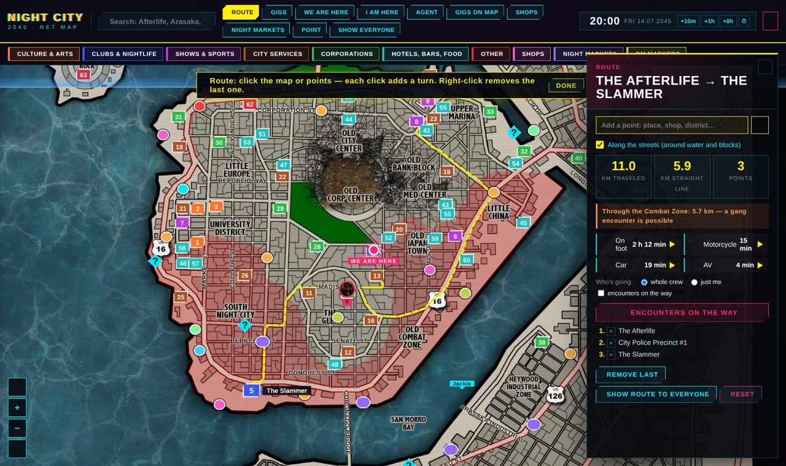 | 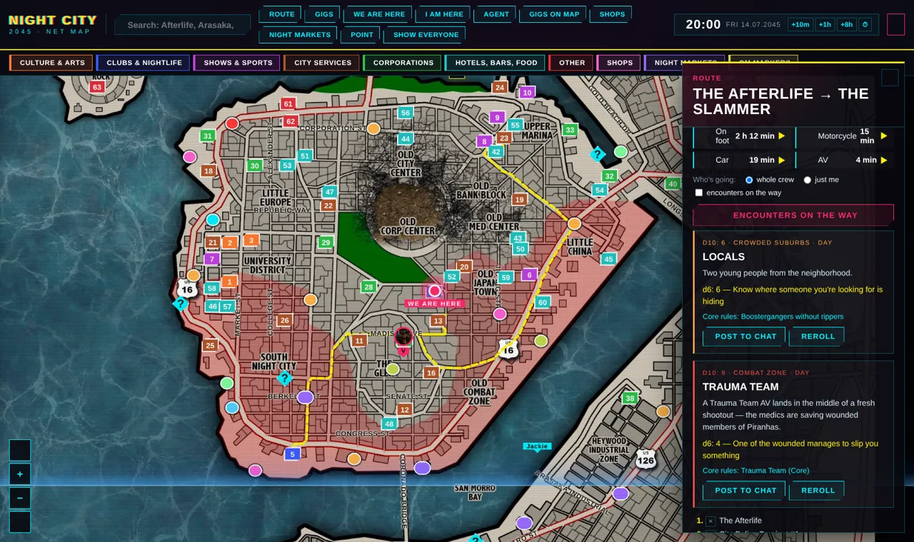 |

### Places and dossiers
Every location has a description, district, nearest street and gigs tied to it. 65 locations come with full-screen art dossiers you can show to all players at once.

| Place | Dossier |
|---|---|
| 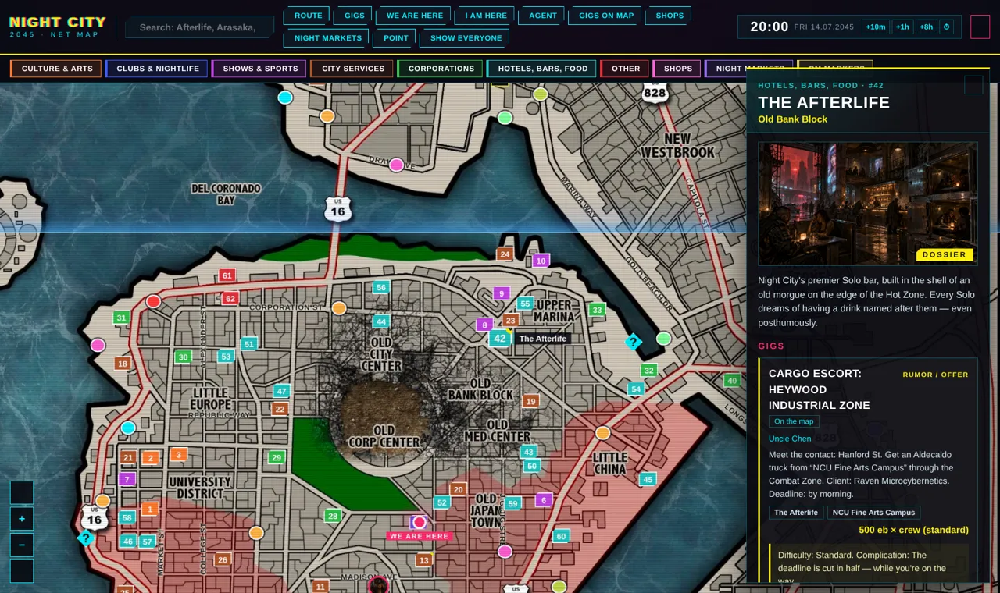 | 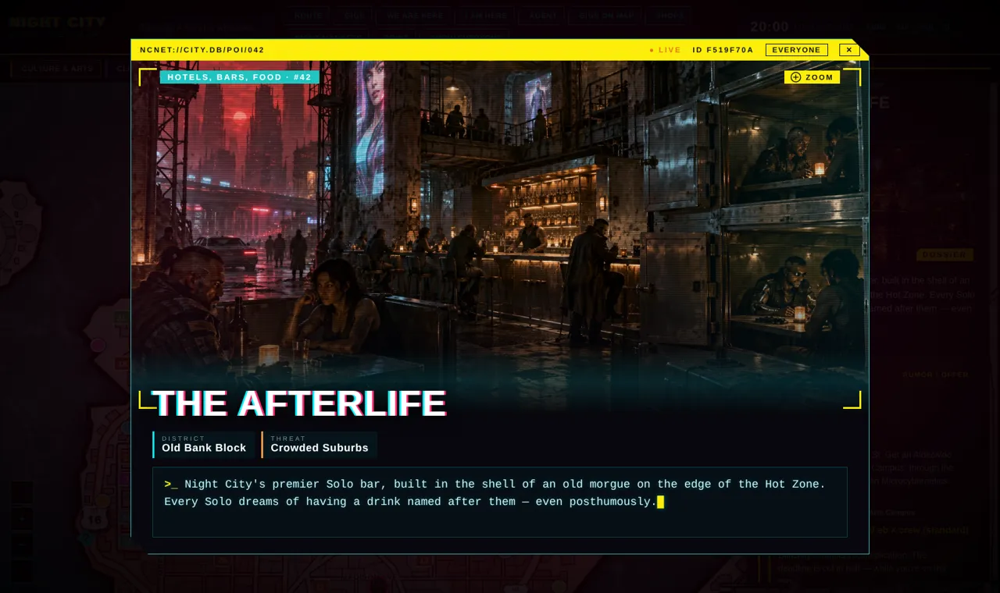 |

### Encounters and districts
Random encounters use day and night tables by district threat level. With the *Night City Gang & Corp Mook Pack* installed, the right enemies are one click away from the scene. A district card lists its threat level and every place in it.

| Encounter | District |
|---|---|
| 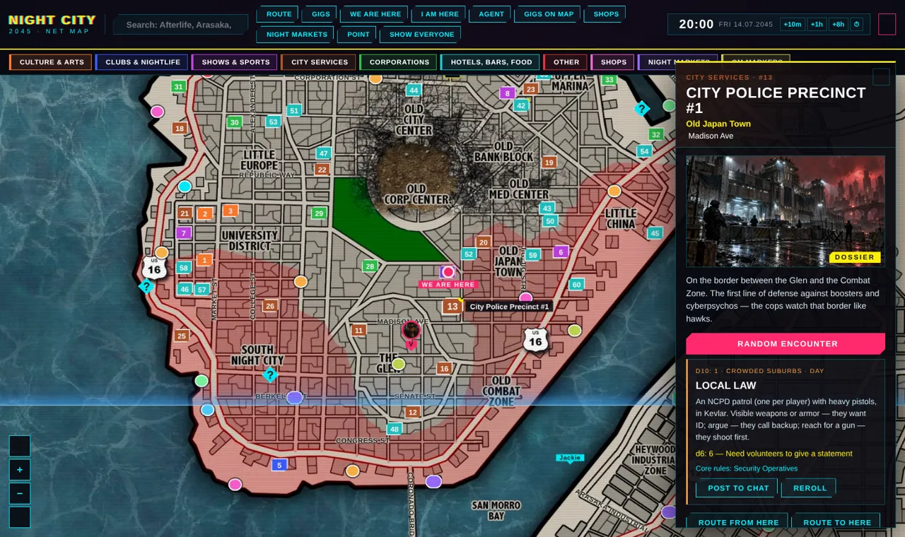 | 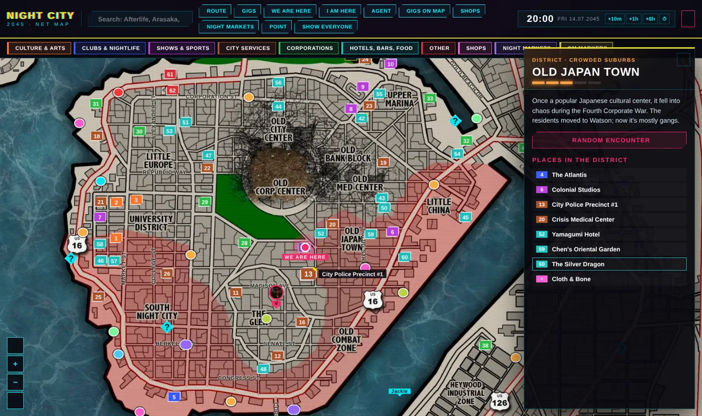 |

### Shops and Night Markets
Procedural shops with Core rulebook price categories and a district markup. Night Markets only open after 21:00; players need Reputation and a fixer's referral to get in.

| Shop | Night Market |
|---|---|
| 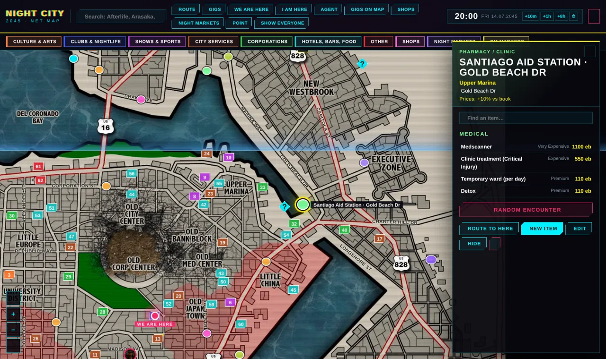 | 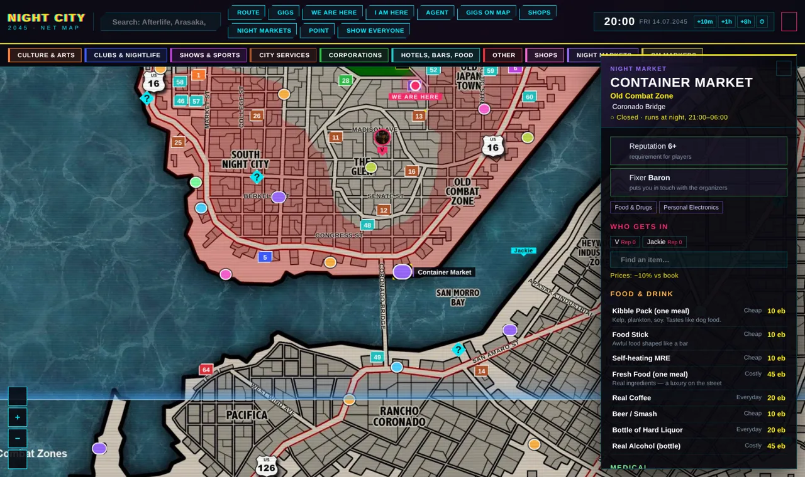 |

### Gigs and time
A gig generator, a gig board, and “?” rumors on the map that players can take themselves. The clock runs on its own or syncs with Simple Calendar; at night the map goes dark.

| Gigs | Night |
|---|---|
| 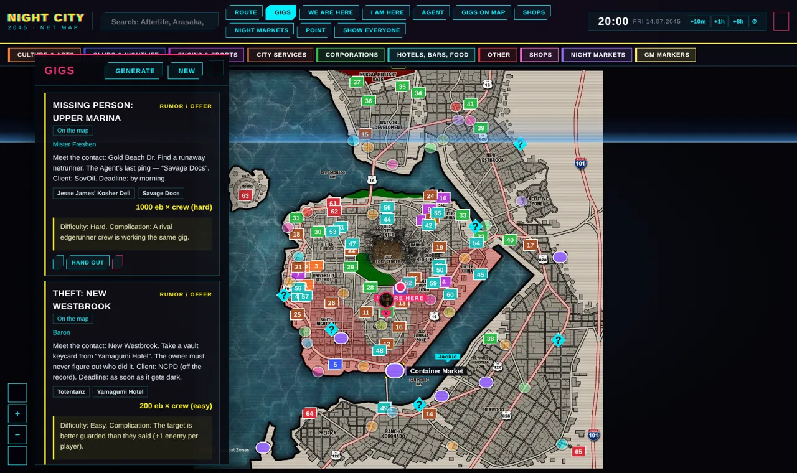 | 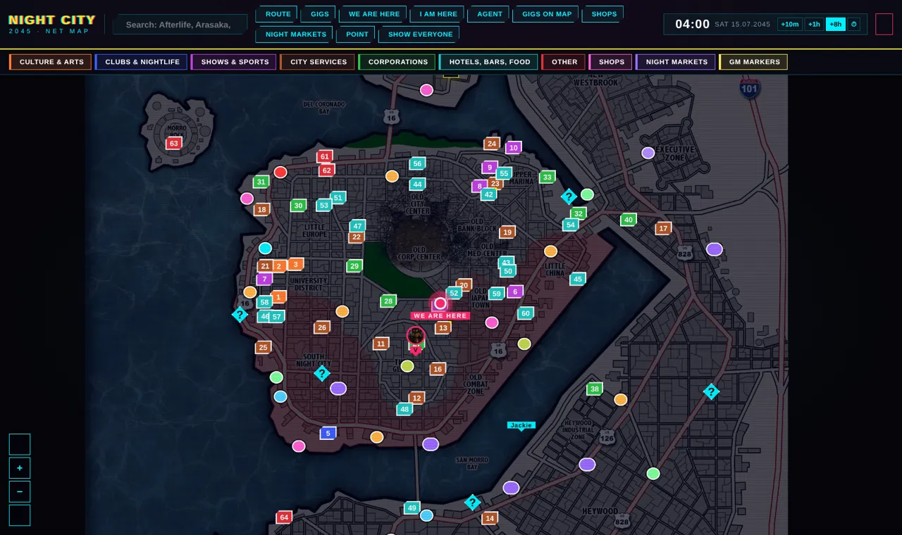 |

### The Agent
An in-game phone for every player: chats with the GM and fixers, available gigs, your position and the crew's.

**Holo-calls:** the GM calls players as any NPC — from the Agent, the actor's context menu, the **Call** button on an actor sheet, or a macro (`NightCityMap.call({ from, img, to, text })`). Players get an incoming call with a portrait and a ringtone, accept or decline, and talk in subtitles. Pick your own ringtone in the module settings. **Contacts:** the GM adds NPCs to the Agent's contact list and picks who sees them; players can call those contacts, and the GM answers as the NPC.

| Chats | Gigs | Position |
|---|---|---|
| 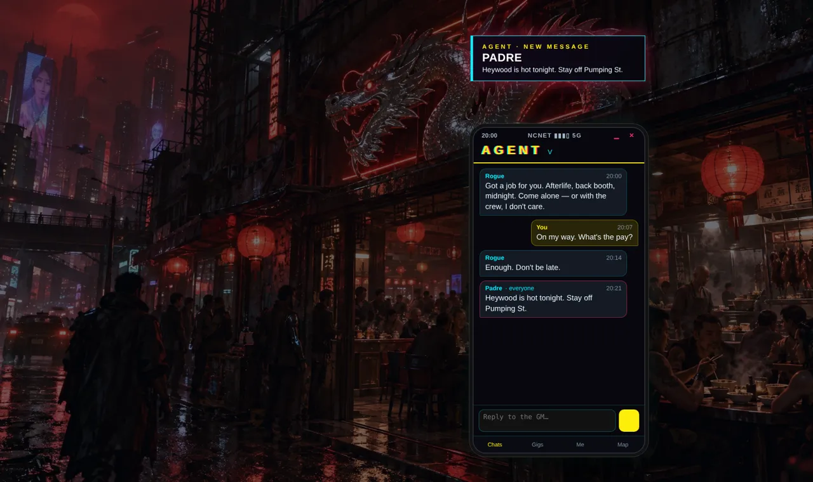 | 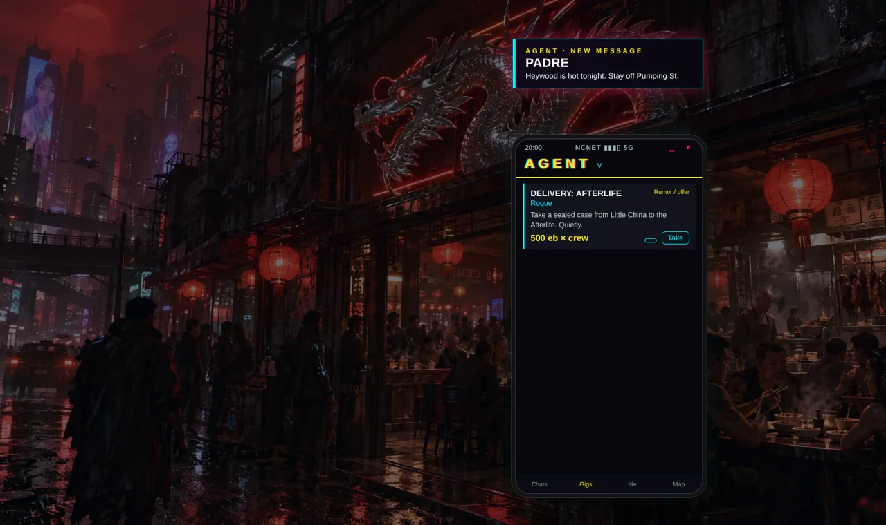 | 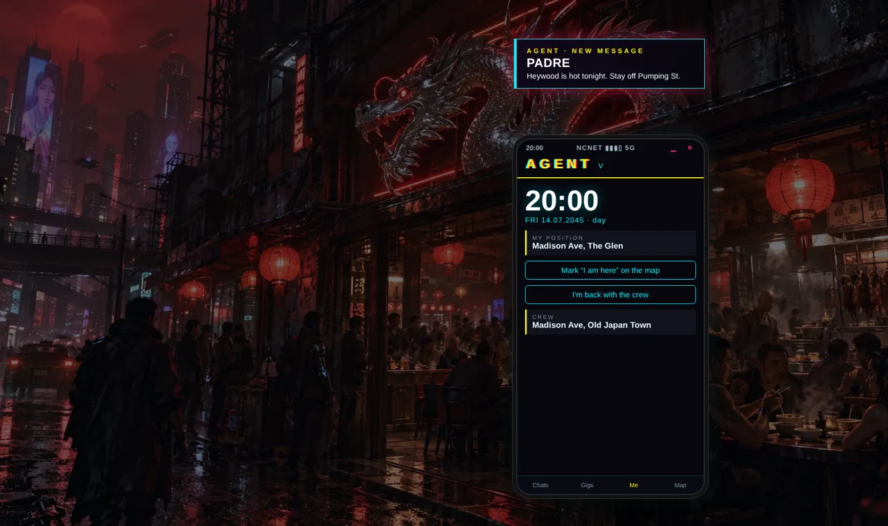 |

### What players see
Players get the same map without the GM tools: places, rumors, routes and their own markers.

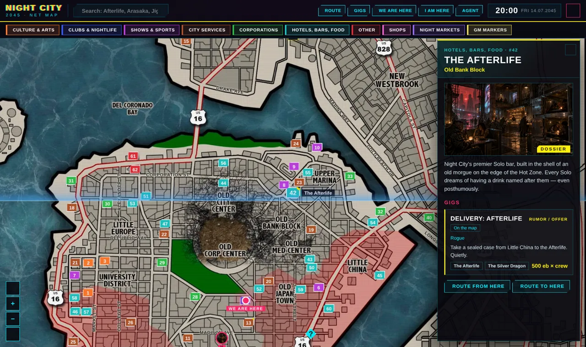

### Your own city
Edit, move or remove any place, built-in ones included, add your own with art and categories, write your own random encounters, and carry it all between worlds with export and import. Swap the map image in the settings and you can run a different Night City, 2077 included.

### Shopping
Players buy from shops and Night Markets right on the map. In Cyberpunk RED the eddies come off the character and the item lands on the sheet; the GM can approve each purchase.

Also included: 24 ready-made street NPCs (fixers, threats, specialists) in an English and a Russian compendium.

## Install

In Foundry: **Add-on Modules → Install Module**, paste this manifest URL:

```
https://github.com/samroaleksej-bit/night-city-map/releases/latest/download/module.json
```

Foundry v12. The system is Cyberpunk RED Core (the map itself works with any system; the NPC compendium needs Cyberpunk RED).

Recommended: [Simple Calendar](https://foundryvtt.com/packages/foundryvtt-simple-calendar), *Night City Gang & Corp Mook Pack*.

## Using your own map

The built-in map image is **2079 × 2025 px** (about 1.03 : 1). Places, districts and streets are stored as fractions of the image, so any image with the same proportions lines up; a different shape or a different city needs your own places (Places → Remove all built-in, then add yours).
- **Map image** (settings): your background. Any resolution; 2000–4000 px wide works well.
- **Map width, km** (settings, default 14): the real width of the image, used for distances and travel time.
- **Road grid image** (settings): the grid routes follow, **693 × 675 px** for the built-in map (a third of the map size). White = street, gray = land, black = water. Same proportions as your map; any resolution.
- Small road fixes can be painted right on the map with the **Roads** button.
- **Shops**: random shops along the roads, or **Place manually** to put one exactly where you want it. The GM can edit any shop's stock: custom prices, remove items, add your own.
- **Reset to defaults**: Places → Reset… Map data is stored in the world, so reinstalling the module does not reset it — use this instead.
- **Place scenes**: link any place to a battle-map scene (Edit → Place scene); the GM opens it or moves the players there from the place panel.
- **Districts** button: your own district names (with danger) and street labels for a custom map, or start from the built-in ones and move/rename them. Addresses, encounters, shops and gigs follow them.
- Moving your setup between worlds: **Places → Export / Import** carries points, place edits, roads, districts and streets, encounters, shops, markets, gigs and contacts.

## Language

The module speaks English and Russian. By default it follows Foundry's language; you can force a language in the module settings (**Map language**). English Foundry gets the English map image, Russian Foundry gets the Russian-labeled one.

Want another language? Copy `scripts/lang/en.js`, translate the values (the keys are the Russian source strings) and open a pull request.

## Credits and legal

Unofficial fan content, free and non-commercial. Not approved or endorsed by R. Talsorian Games or CD PROJEKT RED.
*Cyberpunk* and *Cyberpunk RED* are trademarks of CD PROJEKT S.A. and R. Talsorian Games Inc. Night City locations, districts and price categories are referenced from the Cyberpunk RED Core rulebook; all descriptions are written for this module. Street names are from *Cyberpunk 2077*.
Base map: the unofficial “Night City 2045” map by The Writers' Cthulhu (r/cyberpunkred).
Module code and texts: Verlierboy · [Circle of Masters](https://t.me/circleofdms).

---

## Русский

Интерактивная карта Найт-Сити 2045 для **Cyberpunk RED** в Foundry VTT. Карта открывается по **Shift+M**, телефон «Агент» по **Shift+A**.

Что внутри:
- 65 мест и 21 район по Корке RED, улицы из Cyberpunk 2077, Боевые зоны и Зона Поражения;
- маршруты по улицам со временем в пути;
- случайные встречи по уровню угрозы района;
- заказы фиксеров и слухи «?» на карте;
- магазины и Ночные рынки с ценами по книге;
- метки «Мы здесь» и «Я здесь»;
- телефон «Агент»: чаты, контакты и голо-звонки (мастер звонит от имени NPC, игроки звонят контактам; своя мелодия — в настройках);
- часы и календарь, синхронизация с Simple Calendar;
- свои места, правка и перенос встроенных, свои встречи, экспорт и импорт;
- своя карта: свои районы с опасностью и подписи улиц (кнопка «Районы»), своя сетка дорог;
- покупки в магазинах прямо с карты (эдди списываются с персонажа);
- компендиум из 24 NPC.

**Установка:** в Foundry открой «Дополнения», нажми «Установить модуль» и вставь манифест:

```
https://github.com/samroaleksej-bit/night-city-map/releases/latest/download/module.json
```

**Своя карта:** картинку и сетку дорог (белое - улицы, серое - суша, чёрное - вода, те же пропорции) ставишь в настройках модуля. Районы и улицы - кнопка «Районы»: свои или встроенные за основу. Магазин в нужное место - «Магазины» → «Поставить вручную». К любому месту можно привязать боевую карту-сцену (Править → «Сцена места»), мастер открывает её или переносит туда игроков прямо из панели места. Перенос всего между мирами - «Места» → Экспорт / Импорт.

**Язык:** по умолчанию как у Foundry. Выбрать вручную можно в настройках модуля, пункт «Язык карты».

Неофициальный фанатский проект, бесплатный и некоммерческий.
