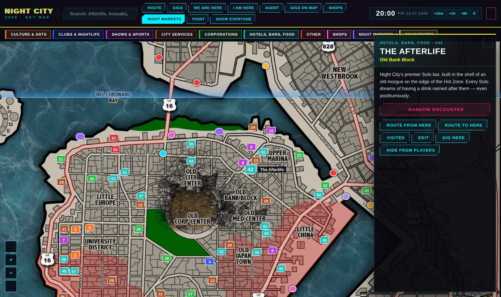
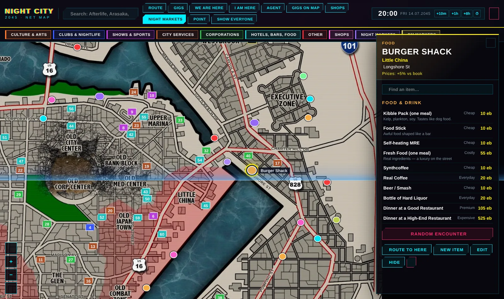
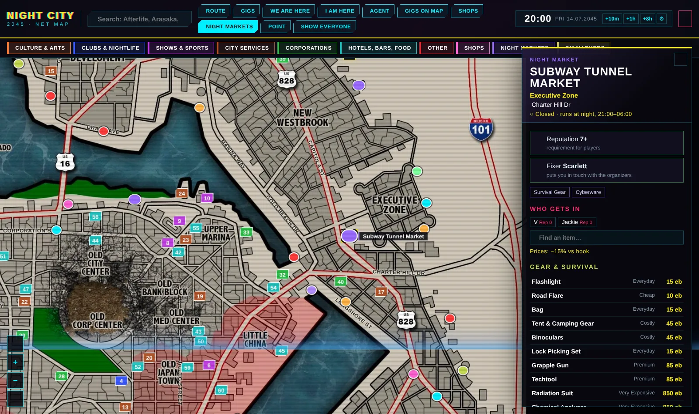
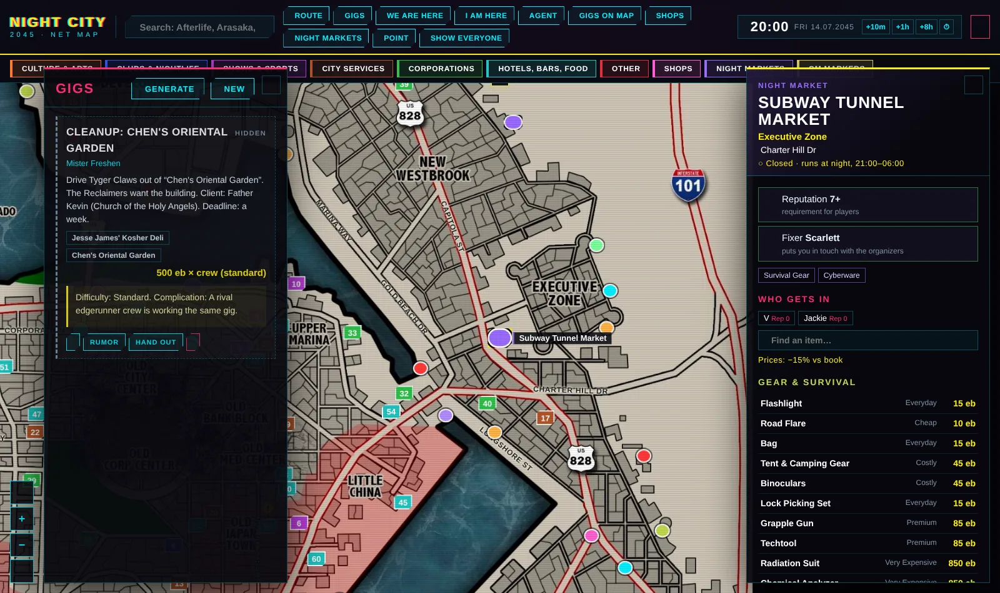
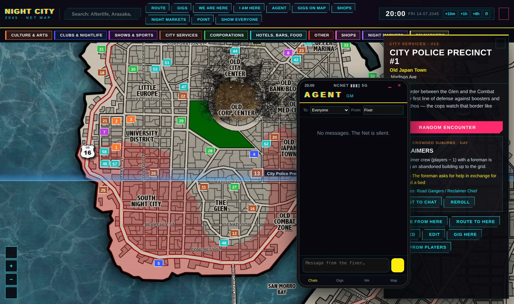

# Night City · Interactive Map (Foundry VTT)

**English** · [Русский](#русский)

An interactive Night City 2045 map for **Cyberpunk RED** in Foundry VTT. Open it with **Shift+M**, open the Agent phone with **Shift+A**.



## What it does

- **65 locations and 21 districts** from the Cyberpunk RED Core rulebook, with street names from Cyberpunk 2077, the Combat Zones and the Hot Zone.
- **Routes along real streets**: travel time on foot, by bike, car or AV, plus warnings when the route crosses a Combat Zone or the Hot Zone. Press *Travel* and the clock moves and the marker goes to the end of the route.
- **Random encounters** by district threat level (day and night tables). If the *Night City Gang & Corp Mook Pack* is installed, the enemies are one click away from the scene.
- **Fixer gigs**: a generator, a gig list, and “?” rumors on the map that players can take themselves.
- **Shops and Night Markets**: procedural stock with Core rulebook price categories and a district markup. Night Markets only open at night and need Reputation and a fixer's referral to get in.
- **“We are here”** for the whole crew and **“I am here”** for each player when the crew splits.
- **The Agent**: a phone with gigs, messages between the GM and players, and your position.
- **Clock and calendar**: works on its own or syncs with Simple Calendar (the “Night City 2045” calendar is set up with one button).
- **NPC compendium**: 24 ready street NPCs (fixers, threats, specialists) in English and Russian.

| Shop | Night Market | Gigs | Encounter |
|---|---|---|---|
|  |  |  |  |

## Install

In Foundry: **Add-on Modules → Install Module**, paste this manifest URL:

```
https://github.com/samroaleksej-bit/night-city-map/releases/latest/download/module.json
```

Foundry v12. The system is Cyberpunk RED Core (the map itself works with any system; the NPC compendium needs Cyberpunk RED).

Recommended: [Simple Calendar](https://foundryvtt.com/packages/foundryvtt-simple-calendar), *Night City Gang & Corp Mook Pack*.

## Language

The module speaks English and Russian. By default it follows Foundry's language; you can force a language in the module settings (**Map language**). English Foundry gets the English map image, Russian Foundry gets the Russian-labeled one.

Want another language? Copy `scripts/lang/en.js`, translate the values (the keys are the Russian source strings) and open a pull request.

## Credits and legal

Unofficial fan content, free and non-commercial. Not approved or endorsed by R. Talsorian Games or CD PROJEKT RED.
*Cyberpunk* and *Cyberpunk RED* are trademarks of CD PROJEKT S.A. and R. Talsorian Games Inc. Night City locations, districts and price categories are referenced from the Cyberpunk RED Core rulebook; all descriptions are written for this module. Street names are from *Cyberpunk 2077*.
Base map: the unofficial “Night City 2045” map by The Writers' Cthulhu (r/cyberpunkred).
Module code and texts: Verlierboy · [Circle of Masters](https://t.me/circleofdms).

---

## Русский

Интерактивная карта Найт-Сити 2045 для **Cyberpunk RED** в Foundry VTT. Карта открывается по **Shift+M**, телефон «Агент» по **Shift+A**.

Что внутри:
- 65 мест и 21 район по Корке RED, улицы из Cyberpunk 2077, Боевые зоны и Зона Поражения;
- маршруты по улицам со временем в пути;
- случайные встречи по уровню угрозы района;
- заказы фиксеров и слухи «?» на карте;
- магазины и Ночные рынки с ценами по книге;
- метки «Мы здесь» и «Я здесь»;
- телефон «Агент»;
- часы и календарь, синхронизация с Simple Calendar;
- компендиум из 24 NPC.

**Установка:** в Foundry открой «Дополнения», нажми «Установить модуль» и вставь манифест:

```
https://github.com/samroaleksej-bit/night-city-map/releases/latest/download/module.json
```

**Язык:** по умолчанию как у Foundry. Выбрать вручную можно в настройках модуля, пункт «Язык карты».

Неофициальный фанатский проект, бесплатный и некоммерческий.
